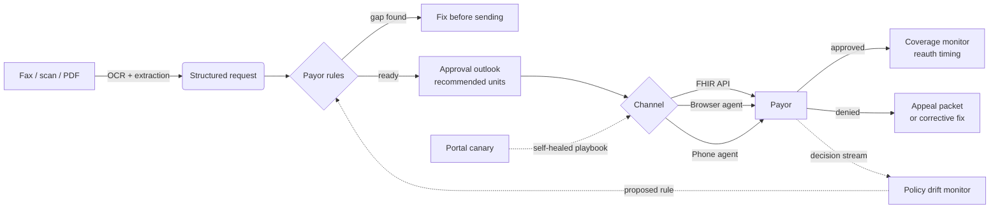
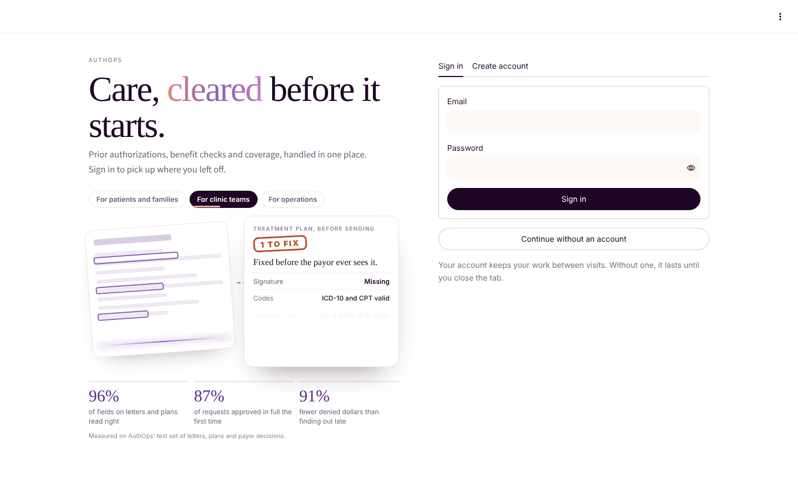
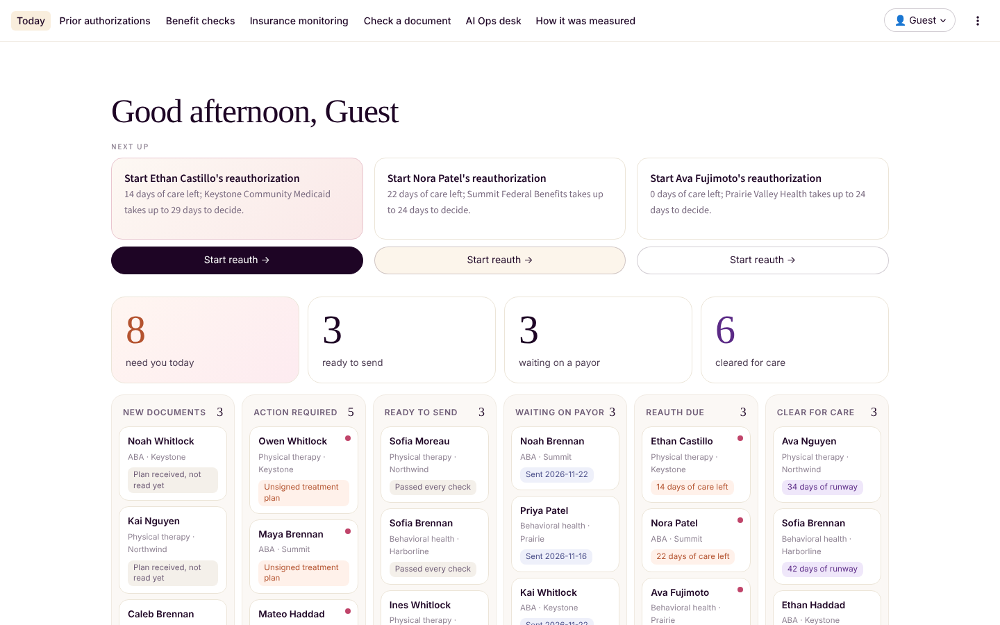
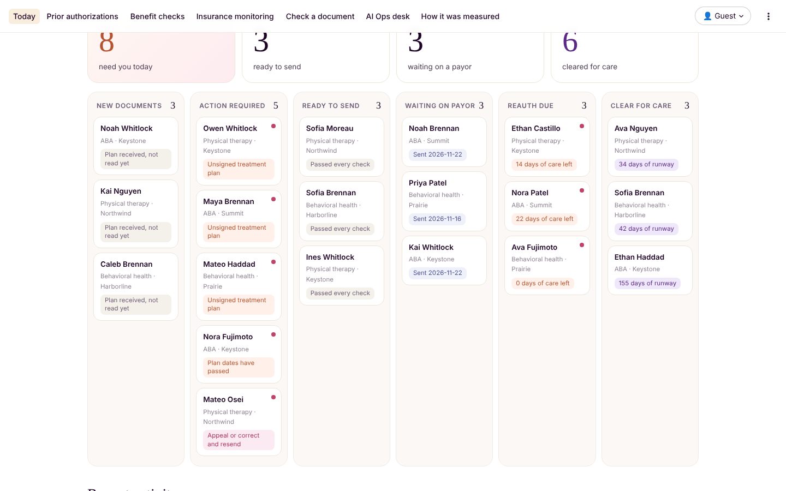
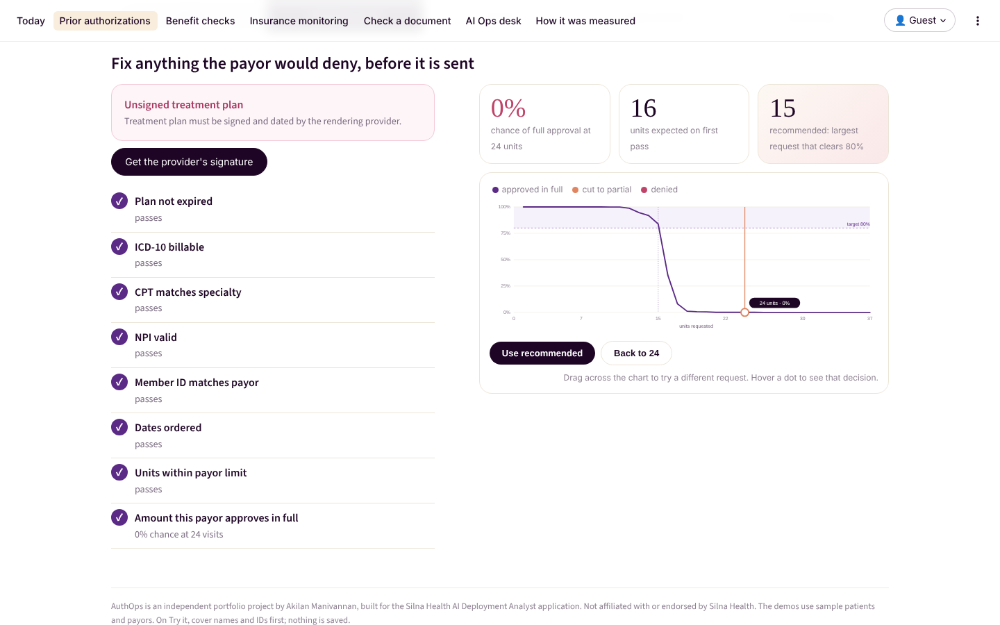
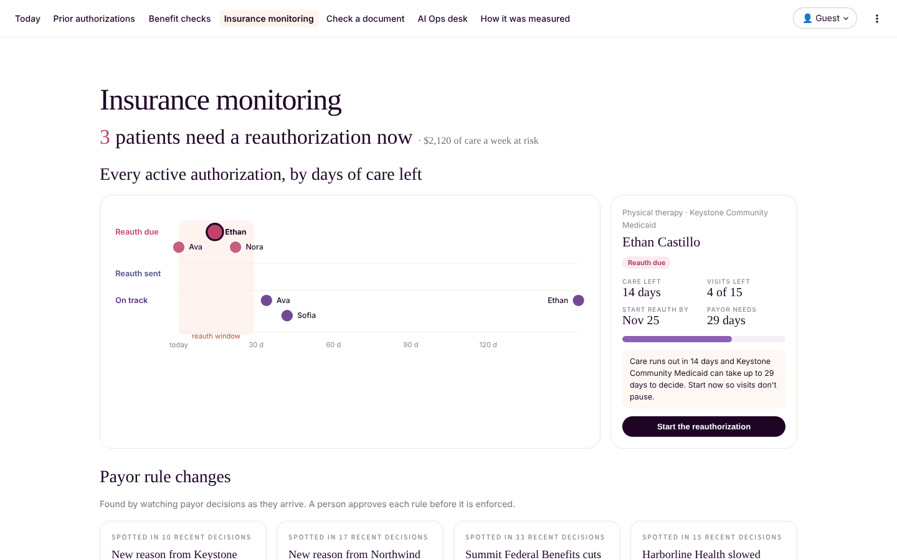
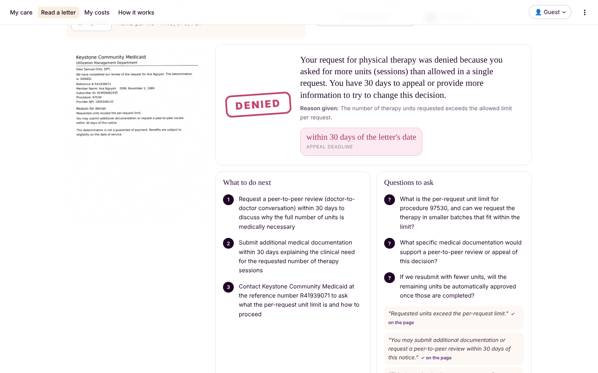

# AuthOps

**Prior-authorization operations, end to end: read the documents, catch denials before they happen, submit through any channel, and keep rules and playbooks current on their own.**

[](https://akilan-silna-pa-agent.streamlit.app)


**Accounts and roles:** sign in, choose patient, clinic or AI operations, and work on one shared workspace where every action shows up on every page, with "Next up" suggestions.

**Use it on a real document:** on *Try it on your document*, a patient or family can upload an insurance letter and get the
decision, dates, appeal deadline and next steps in plain English; a clinic can upload a treatment plan and see what to fix
before it goes to the payor. Claude reads the page; deterministic checks (NPI checksum, ICD-10 and CPT shape, dates,
signature) run alongside it, and every quote the AI returns is checked against the page. Nothing is stored.

> Independent portfolio project by Akilan Manivannan. Not affiliated with or endorsed by Silna Health. The demos use synthetic patients, providers and payors.

## How a request moves



## What it does

| | |
|---|---|
| 📄 **Reads documents** | OCR + field extraction with confidence; abstains when unsure. Long charts (12-150 pages) checked by a background agent that cites every page |
| 🛡️ **Prevents denials** | Payor rules block gaps before submission; an approval model recommends how many units to request |
| 🤖 **Submits anywhere** | Browser agent on four sandbox portals (pop-ups, iframes, MFA, lockouts), FHIR prior-auth API, phone IVR |
| 📡 **Stays current** | Detects unannounced payor rule changes from the decision stream; heals playbooks when a portal is redesigned |
| ⚖️ **Handles denials** | Triage: appeal with verified citations, corrective resubmission, or specialist review |
| 📈 **Earns autonomy** | Human QA share drops only while results hold; prompt changes pass a regression gate |

<p>






</p>

## Results

| | |
|---|---|
| **0 vs 5** | false passes, background document agent vs a single model call, on 30 charts up to 150 pages |
| **86.7%** | requests approved in full on first pass with the unit recommendation (37.9% asking for the clinical need) |
| **100%** | unit caps and new payor requirements detected, median 0 weeks after the change |
| **3 / 3** | submissions on a portal nobody configured by hand (auto-drafted playbook) |
| **96.0%** | fields read correctly from 160 faxes and scans, 0.5% wrong without a human check (91.8% and 1.3% before checksum and format-guided OCR repair) |
| **4 → 0** | wrong-data submissions with the turn validator when 25% of typed values are corrupted (0 false blocks in 40 clean runs) |
| **99.4%** | benefits-call fields correct with read-back (83.2% without) |
| **17 / 17** | appeal letters with every citation verified against the chart |

All numbers come from synthetic data and are reproducible. Methods, every table and the limits: **[docs/RESULTS.md](docs/RESULTS.md)** · design: **[docs/DESIGN.md](docs/DESIGN.md)**.

## Run it

```bash
pip install -r requirements.txt && python -m playwright install chromium
python scripts/run_all.py          # full pipeline, writes reports/
streamlit run streamlit_app.py     # the app
```

`pytest -q` runs 103 tests, including real-browser runs on every sandbox portal.

## Testing

Tested at three levels, from code up to the full user journey:

| Level | What is checked | Result |
|---|---|---|
| Code | `ruff` lint and `pytest`: extraction, payor rules, approval model, workspace actions, document reader, portal agents in a real browser | 103 / 103 pass |
| Pages | Every page and every tool on it, for each role (patient, clinic, operations): loads without errors, plain professional wording, load time | 35 / 35 views clean, slowest 4.1 s |
| Journeys | Recorded browser runs of real use, with each check shown on screen as it runs | 58 / 58 checks pass |

The recorded journeys:

1. **Accounts:** two people create separate accounts, sign out and back in, keep their own work, never see each other's; a wrong password is refused.
2. **Patient or family:** read an insurance letter, get the decision, deadline and next steps; the letter is kept and the next suggestion changes.
3. **Clinic team:** fix a request from the board, apply the recommended amount, send it; start a reauthorization; approve a payor rule. Every action shows up on the other pages (for example "need you today" 8 → 7, "waiting on a payor" 3 → 4).
4. **Operations:** the review queue first, then every AI Ops desk tab and every prior-authorization tool.
5. **Phone (390 px):** sign-in, the dashboard and the menu, with no sideways scrolling.


The run above is played at 8x speed. Full-length video: [docs/media/ui_test_run.mp4](docs/media/ui_test_run.mp4) (6 min 25 s, download to watch).

Run the journeys yourself against a running app (each one records a video into `tests_ui/runs/`):

```bash
streamlit run streamlit_app.py --server.port 8611      # terminal 1
python tests_ui/run_all.py                              # terminal 2
AUTHOPS_URL=https://akilan-silna-pa-agent.streamlit.app python tests_ui/run_all.py   # or against the live app
```
